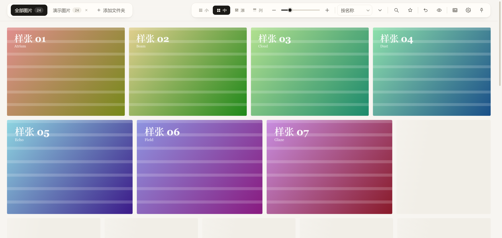
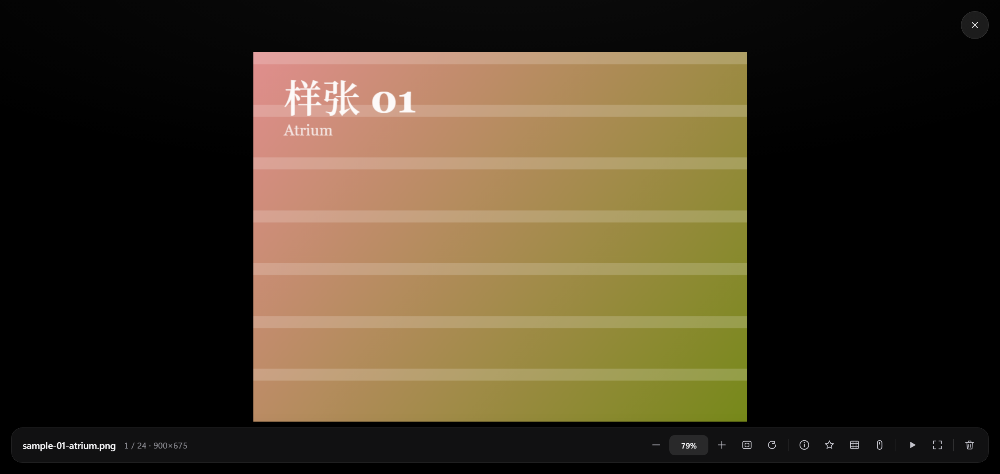

# Atrium

[English](README.en.md) · 简体中文

便携包下载与版本更新说明见 [GitHub Releases](https://github.com/jhlxlml/Atrium/releases/latest)。

Atrium（中庭）是面向 Windows 的本地图片浏览器：选一个文件夹，像翻阅作品集一样浏览你的照片。天光从高处落下、照亮整片陈列空间的地方，照片墙就是中庭。

它只干一件事 —— 把本地文件夹打开，用舒服的方式看图和整理。没有账号、没有云同步、没有遥测，**运行时第三方依赖为 0**，断网状态下功能完全一致（应用**默认完全不出网**；唯一会联网的是一个默认关闭的可选项「检查更新」）。

数据也是自带的：设置、收藏、旋转记录与缩略图缓存都存在**应用目录下的 `data/`** 里 —— 把整个文件夹拷走，就等于带走了全部配置。



*网格视图预览。截图里的 24 张样张由 `?demo=1` 现场合成，不是真实照片。*



*灯箱预览，底部是缩放比例、旋转、EXIF、收藏与幻灯片控制条。*

交付形态只有一种：**Electron 便携包**。解压即用、无需安装。早先的「离线单文件 HTML」版本已在 v1.13.0 退役，对应的构建脚本、回归套件与渲染层浏览器回退分支都已移除。

仓库主要保存源码，**不包含发布 ZIP**（约 112 MB，已在 `.gitignore` 中）—— 便携包请直接从 [Releases](https://github.com/jhlxlml/Atrium/releases/latest) 下载，或按下面的步骤自行构建。

## 功能概览

### 浏览与加载

- 四种排布：小图、中图、**瀑布流**、单列。顶栏图标、设置面板、数字键 `1`–`4`、`M` 循环四种入口同值。
- 小图与中图是**两种视图**，不是同一套布局的两个尺寸档：小图按等边方格排、`object-fit: cover` 裁掉边角，一屏能扫上百张；中图按真实宽高比行内自适应、`contain` 完整显示，绝不裁切。尺寸滑杆在两者里调的分别是「方格边长」和「目标行高」。
- 瀑布流按「最短列优先」分配，列宽可调（120–420 px），列宽重新均分以恰好填满容器；长列表虚拟化，滚动不掉帧。
- 原生目录选择、**拖拽入窗**（文件夹或散图都行）、记住上次目录。拖入的条目没有磁盘路径，索引 / 缩略图 / 灯箱 / 删除四条下游路径单独处理。
- 缩略图**落盘缓存**：二次打开零解码，约 5 倍加速。尺寸库存的是原图真实宽高 —— 靠读文件头拿到，不解码。

### 灯箱与相框

- 灯箱：缩放、拖动、旋转、全屏、幻灯片、缩略条、EXIF、收藏、删除；带对话框语义与焦点陷阱。
- **相框模式**：无边框独立窗，按图片比例自动变形，可拖动、可换屏；渲染进程崩溃后主窗自动恢复。

### 删除与找回

- 删除走**系统回收站**，可恢复；`Ctrl+Z` 撤销；另有回收站视图（记在本机 JSON 日志里）。
- 三档能力探测 —— 环境不支持可恢复删除时**如实告知**，而不是假装成功。

### 整理与检索

- 按文件名搜索、收藏、只看收藏、批量选择。
- 导出选中的图片：**旋转结果真实烘焙进像素**，不是只写个 EXIF 朝向标记。
- 隐私模式：一键糊掉所有图片，截屏 / 投屏时用。

### 格式支持

- JPEG、PNG、GIF、WebP、BMP、AVIF、SVG、ICO、TIFF。
- **HEIC/HEIF 走能力探测**：系统装了 HEVC 解码器就能看，没有就明确标记不可用，而不是无条件判死。全程只探一次并缓存。

### 桌面集成

能交给系统的就不自己画 —— 原生菜单（带加速键）、原生右键菜单（**按当前状态自动置灰**）、系统托盘、任务栏缩略图按钮与进度条、跳转列表、全局快捷键。

设计上有一条：**菜单项的 id 就等于内部命令 id**，所以回归探针可以拿着命令 id 向 Electron 反查"这一项到底绑的什么加速键"，测的是真实装配结果。

### 外观与主题

- **明暗两套配色**，可跟随系统。全部落在 CSS 变量上，JS 只切 `body` 的 `dataset` —— 换主题不碰任何组件样式。
- **强调色可自定义**：六支预设 + 任意取色器（调系统原生取色器，带吸管）。改的不是一个变量，而是**一整套推导出来的令牌** —— 用户选纯黄时白字只有 1.4:1，程序会把压在上面的字换成近黑，而不是为了迁就白字把黄涂成深橄榄。语义色（收藏 / 删除 / 播放）不跟随强调色。
- **灯箱跟随主题**：浅色下是浅幕布（`#ececee`，比页面底再深一档，白底图不会糊进背景），深色下是纯黑。选择条与 Toast 同理。

### 无障碍

四层齐备：播报（52 处操作全覆盖，危险操作走 `assertive` 立即插话）、语义与 `aria-modal`、四个容器共用焦点陷阱、键盘全可达 + 系统动效削减 + 焦点环。

### 关于与更新

「设置 → 关于」里有版本、隐私说明、**数据存放位置**与 **GitHub 仓库链接**，并可**就地检查更新**（读一次 GitHub 的公开版本号）。

更新检测**默认关闭** —— 它是全应用唯一会联网的功能，所以做成可选项：打开后启动时静默检查，只有真发现新版本才提示；没更新或连不上都不打扰你。手动点「检查更新」时三种结果都会说清楚（**"检查失败"绝不会被说成"已是最新"**）。

## 快速开始

### 使用便携包

1. 从 [Releases](https://github.com/jhlxlml/Atrium/releases/latest) 下载 **`Atrium_Electron_v1.20.2_x64.zip`**（Windows x64）和同名的 **`.sha256`**；
2. 解压后双击 **`Atrium.cmd`**（**不是** `Atrium.exe`）；
3. 点「添加文件夹」，或者直接把文件夹 / 图片拖进窗口。

> **建议核对校验和**（v1.20.1 起发布脚本会一并上传 `.sha256`）：
> `sha256sum -c Atrium_Electron_v1.20.2_x64.zip.sha256`（PowerShell：`Get-FileHash`）。

> **为什么是 `.cmd` 而不是 exe**：WorkBuddy 及部分 Node 环境会注入 `NODE_OPTIONS`，Electron 打包版遇到它会**启动即退出**。启动器负责先清掉这个变量，再拉起主程序。它优先按名找 `Atrium.exe`，找不到才退回「目录里第一个 exe」。

> 下载到的资产名是 ASCII 的 `Atrium_Electron_v1.20.2_x64.zip`（后缀标架构，将来出 arm64 包可在同一 release 里共存）
> —— GitHub 的 release 资产名**不支持非 ASCII 字符**（会被替换成 `.`），所以发布时用这个名字；
> 本地 `npm run pack` 生成的 ZIP 仍按构建链的命名带「版」字，两者**内容完全一致**。

> **数据在哪**：解压目录下会自动出现一个 `data/`（设置 / 收藏 / 旋转记录 / 缩略图缓存）。
> 它是**便携**的 —— 拷走整个文件夹就等于带走全部配置，换台机器不用重新配。
> 想清空就整个删掉（或走「设置 → 数据 → 清除缓存」）。

### 从源码构建

环境：**Windows** + Node.js（推荐 20 及以上，实测 22.x）。运行时零依赖，下面两个包**只在构建期**需要。

```bash
git clone https://github.com/jhlxlml/Atrium.git && cd Atrium

# 1. 装构建期依赖（electron + rcedit，约 269 MB，已被 gitignore）
cd deploy/electron && npm i && cd ../..

# 2. 构建便携包 → deploy/dist-electron/
npm run build

# 3. 打包 ZIP → 根目录
npm run pack
npm run verify:zip      # 独立 CRC 校验器 + 7-Zip 第三方复验

# 4. 全量回归（含跑「装进包里的 exe」自检）
npm test
```

### 常用命令

| 命令 | 作用 |
|---|---|
| `npm test` | 全量回归：**46 套件 / 591 项**，约 300 秒 |
| `npm run test:unit` | 只跑纯 Node 单测：**12 个文件**，零依赖、约 3 秒（CI 用这个） |
| `npm run test:fast` | 快跑：13 套件 / 61 项，约 8 秒（**含需要 electron 的 `tf`**） |
| `npm run build` | 构建 Electron 便携包 |
| `npm run pack` | 打成交付 ZIP |
| `npm run verify:zip` | ZIP 独立校验（CRC / 结构 / 第三方复验） |
| `npm run probe -- probe_grid.js` | 跑单个 Electron 探针 |
| `npm run shots` | 重新生成本 README 里的两张截图 |
| `npm run clean` | 清理回归运行期产物（曾攒到 2.5 GB） |

> **`npm test` 依赖构建产物**：`appself` 套件跑的是 `deploy/dist-electron/` 里的真实 exe（它正是"最接近真实用户"的那一层），`zip` 套件读根目录的交付 ZIP。**新克隆请先 `npm run build`（和 `npm run pack`）再跑全量回归**，否则这两套会失败 —— 这不是回归本身有问题，而是它们**故意不肯在产物缺失时假装通过**。只想验证源码改动的话，用 `npm run test:fast`。

## 快捷键

按 **`F1`** 在应用内随时打开这张表（内容全部来自实际绑定，不写"计划中"的项）。

| 按键 | 作用 |
|---|---|
| `Ctrl+O` | 打开文件夹 |
| `Ctrl+E` | 导出选中的图片 |
| `Ctrl+1` `Ctrl+2` `Ctrl+3` `Ctrl+4` | 小图 / 中图 / 瀑布流 / 单列 |
| `Ctrl+Plus` `Ctrl+-` `Ctrl+0` | 放大 / 缩小 / 重置尺寸 |
| `Ctrl+L` | 只看收藏 |
| `Ctrl+B` | 模糊预览（隐私模式） |
| `Ctrl+Shift+B` | 展开 / 收起来源栏 |
| `Ctrl+T` | 窗口置顶 |
| `Ctrl+Shift+F` | 相框模式 |
| `Ctrl+A` / `Ctrl+Shift+A` | 全选当前页（图库内 / 菜单） |
| `1` `2` `3` `4` / `M` | 切换排列模式 / 依次循环 |
| `F` / `/` | 只看收藏 / 搜索文件名 |
| `+` `-` | 放大 / 缩小瓦片 |
| `Delete` | 删除选中（移入回收站） |
| `空格` | 灯箱内：下一张 |
| `F11` / `F1` | 全屏 / 打开快捷键表 |
| `Esc` | 取消选择 / 关闭面板 / 退出回收站 |

在图片上点**右键**会弹出**原生菜单**（打开、上一张 / 下一张、旋转、收藏、全屏、在文件夹中显示、导出、删除、全选），并随当前状态自动置灰。

## 架构

**五层，单向依赖** —— 上层可以依赖下层，下层绝不反向依赖上层。

```
表现层   index.html · main.css / lightbox.css / frame.css
   ↑
交互层   app.js（事件与命令分发）· settings.js · grid.js · lightbox.js · frame.js
   ↑
状态层   state.js（唯一真相源 + 事件总线）· masonry.js / transform.js（纯函数）
   ↑
数据层   loader.js · thumb.js · exif.js · trash.js · util.js · a11y.js
   ↑
平台桥   native.js（渲染侧适配器）──IPC──▶ preload.js（白名单）──▶ main.js / desktop.js
```

几条刻意的设计：

- **纯函数下沉**：几何计算（排布、缩放、居中、旋转）、更新检测的规则（版本比较、URL 白名单）、回收站的 `$I` 判据、`vf://pic` 的读盘授权、崩溃兜底页的生成，全部抽成不依赖 DOM / 不依赖 Electron 的纯函数，于是可以在 Node 里毫秒级跑 **1349 条**细分断言，不需要开窗口。
- **`desktop-spec.js` 是纯数据**（菜单模板 / 加速键 / 命令词表），**不许 `require('electron')`** —— 所以它能在 Node 里被 76 条断言直接测。
- **安全基线**：`contextIsolation: true` / `nodeIntegration: false` / `sandbox: true`、严格 CSP（无 `bypassCSP`、无 `unsafe-inline`）、自定义 `vf://` 特权协议、preload 白名单、拒绝新窗口与外部导航；每条 IPC **统一校验 sender 归属**，非受信调用直接抛错；**权限请求一律显式拒绝**（不依赖 Electron 默认值）。**打开外部链接也走白名单** —— 只放行官方仓库，由 21 条反向用例锁住。

## 工程与回归

这个项目尽量把「踩过的坑」变成**机制**。当前口径：

| 指标 | 值 |
|---|---|
| 回归 | **46 套件 / 591 项断言**，任一失败**非零码退出** |
| 源码规模 | `js/` 10400 行 / 16 模块 · `css/` 2414 行 / 3 文件 · `index.html` 444 行 · 主进程侧 3393 行 / 8 文件 · `test/` 2759 行 / 12 文件 |
| IPC | 37 条 invoke + 1 条 render→main + 3 条 main→render = **41 个唯一通道名** |
| 运行时依赖 | **0**（`electron` 与 `rcedit` 均只在构建期） |

回归体系里有几层是**相互独立的防线**：

- **跑真实产物**：`appself` 直接运行**装进包里的 exe**，走引导 → 索引 → 解码 → 删除 → 还原 → 批量 → 框选 → 灯箱 → EXIF → 窗口置顶的全链路。
- **校验器自带反向门禁**：ZIP 的 CRC 校验用 Node 原生 `zlib.crc32` 作参照值（**与被测写入器不同源**），并现场造坏包证明它真的会拒；图标校验器**不复用生成代码**（自己校验自己等于自证）。
- **字节级判据**：验证 exe 图标不是"构建没报错"，而是把 `.ico` 里 7 张内嵌 PNG 的字节拿去 `exe.indexOf` 逐个查 —— 7 个全部命中，同一张在原始 `electron.exe` 里是 `-1`。
- **源级不变量**：`frozen` 套件锁住一批「改了就会**清空用户数据**」的字符串（`vf://app`、3 个 `localStorage` 键、`viewfinder-db`、`com.atrium.app`、`productName`），以及**数据目录的两条分支**（`VF_USERDATA` 优先级 / 应用目录下的 `data/`）；`ipcchain` 套件核对 preload 暴露的每条通道都有 handler，漏一条就是**静默降级**；`buildsafe` 套件**真的跑一次 robocopy**，证明 `npm run build` 不会删掉 `data/`（并故意去掉 `/XD` 做反向验证）；`secboot` 套件锁住安全默认值（无 `bypassCSP`、严格 CSP、沙箱不静默降级、IPC 校验来源）。
- **安全判据也进回归**：`update` 套件用 **21 条反向用例**锁住 `openExternal` 的 URL 白名单（子域名伪装、userinfo 伪装、非默认端口、路径穿越、`file://`、`javascript:` …）；`pathauth` 套件用 **9 条越权路径**锁住 `vf://pic` 的读盘授权（`..` 折叠、前缀无边界、大小写混用）—— 只测"官方链接能过"/"正常文件能读"等于恒真的门禁。删除与导出这两条**破坏性通道**共用同一套授权：能删/能导出的集合不会大于用户亲手打开过的目录，而导出目标只认原生对话框选过的那个。
- **失败要自证原因**：断言消息里带上"播报了几条、最后一条是什么"这类现场信息，避免只看到一句 `false`。

> **口径提醒**：`591` 是**套件级条目数**，不是固定的覆盖率指标 —— 它会随三件事浮动：
> ① 12 个纯函数套件内部各自展开更多细分断言（合计 1385 条），聚合器把它们各按 1 项计入，**别自己相加**；
> ② `zip` 套件有 **2 条条件断言**只在**交付 ZIP 就位**时才跑（源码态、没打包时更少）；
> ③ `appself` 套件一旦「自检整体通过」判负就**提前返回**，后面 31 条相框断言一条都不执行；
> 同理某个探针超时会让该套件只计 2 项（"进程正常退出"+"返回数据"）而跳过其余 ——
> 所以探针被机器负载拖到超时时会明显偏少（少十几项），正常环境跑全是 `591`。
> **数字变小不等于测试变少**，先看是哪一步没有输出。
>
> 另外：`deploy/electron-test/logs/` 里每个 Electron 探针会新建一个 `ud_*` 用户数据目录
> （内含完整的 Chromium Cache，单个上百 MB）。攒到 **900MB+ / 120 个**之后再跑全量，
> 耗时会被拖到 30 分钟以上、并开始出现"探针无输出"的假红 ——
> 跑之前先 `npm run clean`，全量能稳在 5 分钟出头。

## 目录结构

```
Atrium/
├─ index.html            应用外壳（含内联 SVG 图标精灵）
├─ js/                   渲染层全部逻辑（15 个模块，IIFE 挂 window）
│   ├─ app.js            事件与命令分发、弹层、轻提示
│   ├─ state.js          唯一真相源 + 事件总线
│   ├─ grid.js           网格渲染与虚拟化
│   ├─ masonry.js        瀑布流纯函数
│   ├─ transform.js      缩放 / 旋转 / 居中纯函数
│   ├─ lightbox.js       灯箱
│   ├─ frame.js          相框模式
│   ├─ loader.js         目录扫描与拖拽导入
│   ├─ thumb.js          缩略图与落盘缓存
│   ├─ exif.js           EXIF 读取
│   ├─ trash.js          删除与找回
│   ├─ native.js         平台桥适配器
│   ├─ settings.js       设置面板
│   ├─ a11y.js           无障碍（播报 / 焦点陷阱）
│   └─ util.js           工具与文件头解析
├─ css/                  3 个样式文件
├─ brand/                品牌资产（手写矢量 SVG + 七尺寸 .ico）
├─ docs/                 README 截图与文档配图
├─ data/                 应用数据（设置 / 收藏 / 缓存；**不入库**）
├─ test/                 Node 纯函数单测
└─ deploy/
    ├─ electron/         主进程侧：main / preload / desktop / desktop-spec / exportlib / updatelib
    ├─ electron-test/    回归体系：run_all + 18 个 Electron 探针 + 门禁脚本
    ├─ release/          发布流程（RELEASE.md）
    ├─ make_icons.js     SVG → 七尺寸 .ico（用项目自带的 Electron 当渲染器）
    ├─ verify_clone.js   新克隆可构建性门禁
    └─ pack.js           打包
```

## 已知边界

- **目前只有 Windows 包**。托盘、任务栏缩略图按钮、跳转列表都是 Windows 原生能力；图标资产也只有 `.ico`，出 macOS 包需要另做 `.icns`。
- **搜索只匹配文件名**，未做 EXIF / 尺寸 / 大小检索。
- **HEIC 能否查看取决于系统解码器**，应用只做能力探测并如实显示，不自带解码库（那会破坏"零依赖"）。
- 无障碍还有两块没做：多选状态的键盘操作、幻灯片播报的节制策略。

## 文档

| 文件 | 内容 |
|---|---|
| [`Atrium_开发上手手册.md`](Atrium_开发上手手册.md) | **操作手册**：命令、五层架构、雷区清单、改设置 / 加 IPC 的标准动作、冻结点 |
| [`Atrium_v1.20.2_更新说明.md`](Atrium_v1.20.2_更新说明.md) | 本版：出错时用户能知道（启动异常写日志并弹框、崩溃有兜底页可重载、权限显式全拒、删除与导出补路径授权、版本号一致性门禁） |
| [`Atrium_v1.20.1_更新说明.md`](Atrium_v1.20.1_更新说明.md) | 上一版：安全性与数据可靠性修复（构建不再删 `data/`、打包允许清单、撤销删除的 32 位截断、CSP、沙箱不静默降级、`vf://pic` 读盘授权、Electron 33→45） |
| [`Atrium_v1.20.0_更新说明.md`](Atrium_v1.20.0_更新说明.md) | 上一版：强调色可自定义（一支色推导成整套令牌）/ 灯箱跟随主题 |
| [`Atrium_v1.19.0_更新说明.md`](Atrium_v1.19.0_更新说明.md) | 上一版：全站对比度实测 / 焦点环被裁 / 命中框 24px / 窄窗「设置」被挤出屏幕 |
| [`Atrium_v1.18.0_更新说明.md`](Atrium_v1.18.0_更新说明.md) | 更早：图标统一 Lucide / 字号收成 8 档 / 颜色语义分工 / 修选择条折行 |
| [`Atrium_v1.17.2_更新说明.md`](Atrium_v1.17.2_更新说明.md) | 更早：单列整屏时顶栏背后不再透出上一张图 |
| [`Atrium_v1.17.0_更新说明.md`](Atrium_v1.17.0_更新说明.md) | 更早：Apple HIG 重做界面 / 来源栏搬到左侧 / 两种网格视图 |
| [`Atrium_v1.14.0_更新说明.md`](Atrium_v1.14.0_更新说明.md) | 更早：数据便携化 / 关于面板 / 更新检测 |
| [`Atrium_v1.13.0_更新说明.md`](Atrium_v1.13.0_更新说明.md) | 更早：更名 Atrium / 桌面集成 / 只留 Electron |
| [`deploy/release/RELEASE.md`](deploy/release/RELEASE.md) | 发布流程：固定顺序、验收标准、打包高危坑 |

## 许可证

项目采用 [GNU GPL v3](LICENSE)。

便携包内含 Electron / Chromium 运行时，它们遵循各自的许可证（Electron 为 MIT，Chromium 另附第三方许可清单）；
本仓库的源码部分以 GPL-3.0 授权。
